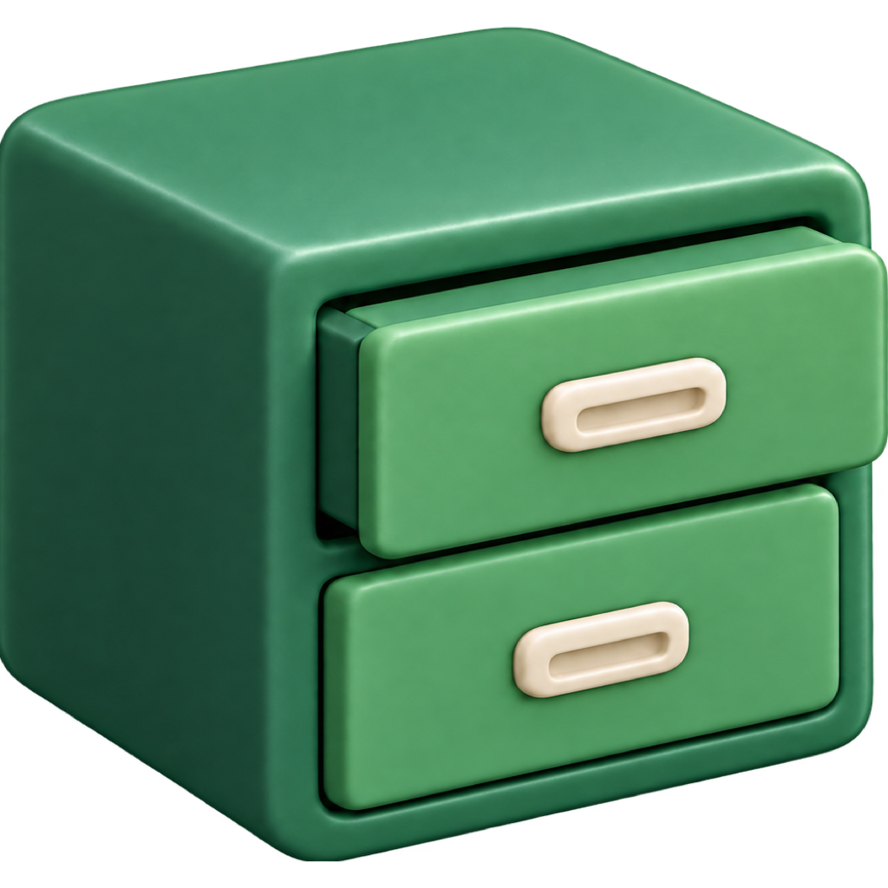

# Rootset

Rootset is open-source, self-hosted master data management for structured data.
Create databases and typed tables, manage records in a spreadsheet-like UI, and
connect applications and AI clients through REST and MCP. PostgreSQL stores your
data, revisions and cell history on your infrastructure.

[Documentation](https://www.rootset.app/overview) ·
[Installation](https://www.rootset.app/self-hosting/installation/docker-compose) ·
[Releases](https://github.com/avgeek-oss/rootset/releases) ·
[Report a bug](https://github.com/avgeek-oss/rootset/issues)

## What you can do

- Group databases in workspaces with immediate membership and workspace-bound API keys.
- Define typed fields, defaults, unique rules and table relations.
- Edit, import, export and duplicate records; save views with filters, sorting
  and column layouts.
- Review cell history and audit logs with context for changes.
- Connect through the REST API or MCP using API keys or OAuth. Admin, Member and
  Viewer roles control access; credentials remain bounded by their permissions.
- Schedule encrypted database backups to S3-compatible storage and restore them
  through the UI, REST or MCP.

## Install Rootset

Use the [Docker Compose guide](https://www.rootset.app/self-hosting/installation/docker-compose)
to run the latest published API, worker and UI images with bundled PostgreSQL.
An existing PostgreSQL database is also supported. Published images support
Linux AMD64 and ARM64.

Rootset needs private S3-compatible storage for artifacts, SMTP for account emails
and HTTPS routes for the UI and API. The guide covers configuration, initial
setup and readiness checks. You can also install through
[Towbar](https://www.rootset.app/self-hosting/installation/towbar).

Before upgrading an existing installation, follow the
[upgrade guide](https://www.rootset.app/self-hosting/upgrades) and keep a recoverable
backup, including the application secret and encryption key.

## Run from source

Use Node.js 24, pnpm 11.5.3 and Docker Compose. Dependencies are available from
the public npm registry; no package-registry credential is required.

```sh
git clone https://github.com/avgeek-oss/rootset.git
cd rootset
pnpm install --frozen-lockfile
pnpm setup:env
docker compose --profile local up --build -d
docker compose --profile local ps
```

Open `http://localhost:4300` and use the generated `ROOTSET_SECRET` from `.env`
to claim the installation and create the first administrator. Keep `.env` private.
The local profile supplies PostgreSQL, object storage and Mailpit. Named volumes
preserve data; `docker compose down --volumes` deletes them.

See the [development installation guide](development/operations/installation.md)
for source builds and runtime requirements.

## Contribute

Read [CONTRIBUTING.md](CONTRIBUTING.md) for development conventions, checks and
migration rules. Bug reports and pull requests are welcome on
[GitHub](https://github.com/avgeek-oss/rootset). Report vulnerabilities privately
using [SECURITY.md](SECURITY.md).

Useful references:

- [Public documentation source](docs) and [documentation tooling](development/documentation.md)
- [Operation catalog](packages/contracts/src) for REST and MCP contracts
- [Operations and recovery](development/operations/README.md)
- [Verification guidance](development/verification/README.md)
- [Changelog](CHANGELOG.md)

## License

Copyright 2026 Avgeek, Inc. Licensed under the
[Apache License, Version 2.0](LICENSE).

Third-party components retain their respective licenses. See [NOTICE](NOTICE)
and the attribution files it lists. Production builds include dependency licenses
and attribution notices.
