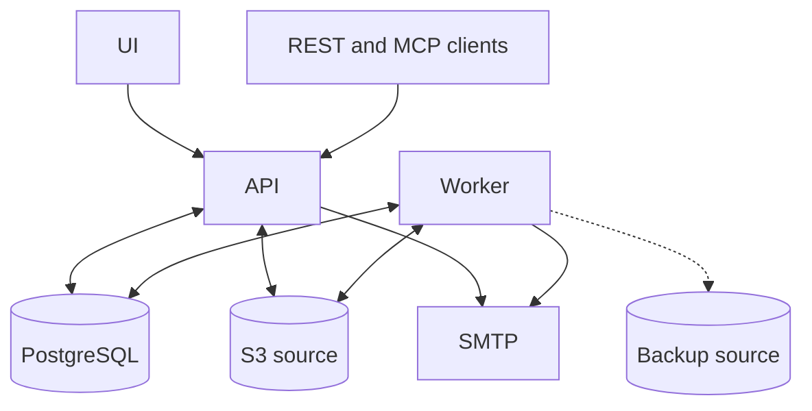

Rootset runs three services: UI, API and Worker. PostgreSQL stores their shared data, and an S3-compatible source stores export artifacts.

| Component  | What it does                                                           |
| ---------- | ---------------------------------------------------------------------- |
| UI         | The web application for tables, records, views and workspace settings. |
| API        | Handles sign-in, permissions, data changes, REST and MCP requests.     |
| Worker     | Processes exports, imports, schema changes and database backups.       |
| PostgreSQL | Stores workspace accounts, table definitions, records and history.     |
| S3 source  | Stores private export artifacts for authenticated downloads.           |
| SMTP       | Delivers account verification, invitations and recovery emails.        |

The UI and API need public HTTPS routes. Browsers and integration clients connect to the API directly. The worker and PostgreSQL stay private. Releases provide matching API, worker and UI images for Linux AMD64 and ARM64; migration commands use the API image.

## Choose an installation method

<CardGroup cols={2}>
  <Card
    title="Docker Compose"
    icon="/assets/installation/docker-compose.png"
    href="/self-hosting/installation/docker-compose"
  >
    Run the published images with Docker, using your own PostgreSQL database or
    the bundled database.
  </Card>
  <Card
    title="Towbar"
    icon="/assets/installation/towbar.png"
    href="/self-hosting/installation/towbar"
  >
    Manage the services through your existing Towbar installation and a
    deployment repository.
  </Card>
</CardGroup>

After installation, review [Configuration](/self-hosting/configuration) and set up [backup and recovery](/self-hosting/backup).
