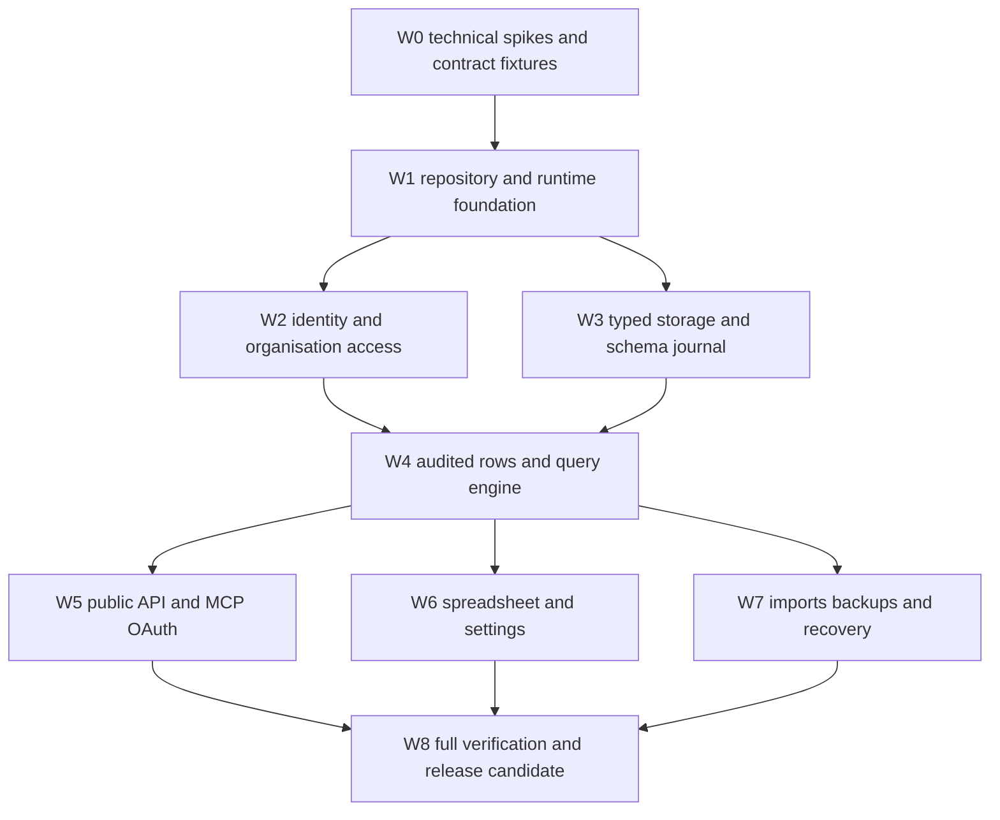

# Implementation plan

Baseline: 2026-10-02. Status: implementation has not started. This document describes work packages and their evidence, not completed work. The [verification checklist](IMPLEMENTATION_VERIFICATION_CHECKLIST.md) defines final sign-off.

## Contract and dependencies

Implement the [account](ACCOUNT_ARCHITECTURE.md), [database](MDM_DATABASE_ARCHITECTURE.md), [API/MCP](API_AND_MCP_ARCHITECTURE.md), and [stack](STACK_ARCHITECTURE.md) contracts. Keep one operation catalog and one limits registry. UI and transport adapters cannot change validation, authority, or persistence behavior independently.

The graph expresses implementation dependencies. It does not require delegated agents or imply that independently built parts are accepted before their shared contracts work together.

## W0: Prove the storage, queue and grid choices

Produce executable, disposable spikes for dynamic typed-table creation, safe DDL journalling/recovery, atomic history, narrow/wide uniqueness under concurrency, query cursor/window navigation, and durable job recovery. Include a forced digest collision in the uniqueness-registry spike.

Build a real spreadsheet route using the candidate grid, all eight editor types, bounded server windows, long-range navigation, a JSON overlay, and keyboard/touch/screen-reader checks. Confirm browser scroll limits are handled. Measure a five-million-row fixture before describing the grid as scalable.

Choose and pin the job queue, date/time conversion library, canonical JSON implementation, grid, query cache, OpenAPI generator and MCP SDK only after compatibility evidence. Record the retained algorithms and rejected tradeoffs in the affected architecture document. Evidence is `DB-06`, `UNI-05`, `JOB-01` through `JOB-05`, `UI-01` through `UI-05`, and the relevant `PERF-*` gates. A spike does not satisfy the final end-to-end gates.

## W1: Establish the repository and installable runtime

Create the planned workspace packages and apps, strict TypeScript configuration, formatting/linting, test runners, forward control-schema migrations, limits registry, ID generation, configuration validation, and shared operation schemas. Add Docker Compose, non-root runtime images, health/readiness, and dependency-independent build steps. Adapt selected Towbar code with source provenance and applicable notices.

Add CI for format, lint, typecheck, unit/integration tests, generated-contract drift, dependency/security checks, and clean build. Keep real external-account changes behind task-specific authorisation; CI should use isolated test storage/mail and local fixtures. Deliver a fresh-clone install and a blank PostgreSQL migration report. Evidence is `DEV-*`, `OPS-*`, and `API-01` through `API-04`.

## W2: Implement identity, accounts and authorisation

Adapt authentication screens and email templates, then implement setup, invitations, ownership, membership/grants, profiles/preferences, passwords, TOTP/recovery, passkeys, sessions, API keys, OAuth grants and account-action approval.

Build the actor/role/resource matrix first. Test session, personal key, team key and delegated OAuth behavior under revocation, role changes, organisation mismatch and last-owner races. Preserve team-key operation when the creator leaves. Record rendered auth/email evidence and real browser factor flows. Evidence is `ACC-*`, `AUTH-*`, and `KEY-*`.

## W3: Implement logical databases and runtime schema management

Create metadata records, managed namespaces, typed physical tables, hidden system columns, field definitions, schema/version journal, RLS and worker privileges. Implement literal defaults, nullability, bounds, schema preview, dependency-safe removal, index/rule build state, and populated-table conversion with staged cutover.

Journal non-transactional DDL and reconcile after forced worker/process failures. Validate actual physical types, constraints, indexes, triggers and privileges through PostgreSQL catalogue/readback. Evidence is `DB-*`, `FLD-*`, and schema-related `UNI-*`/`AUD-*` gates.

## W4: Implement rows, history and queries

Implement canonical serialisation/size measurement, transactional row admission, optimistic concurrency, idempotency, scalar uniqueness, per-cell database history, audit attribution and retained-history lookup. Build the typed query compiler, projection/operators, index management, cursors, live-pagination contract and byte budgets.

Add imports as shared batch operations before large worker imports. Verify same-value updates, rollback, simultaneous updates/inserts, full-table capacity, field deletion/type conversion, and malformed query isolation. Evidence is `ROW-*`, `UNI-*`, `AUD-*`, and `QRY-*`.

## W5: Implement public REST and MCP

Generate and serve OpenAPI, generate the browser client, expose every catalogued public operation, and implement typed errors and rate/job admission. Add remote MCP with negotiated Streamable HTTP, resource-bound OAuth, metadata discovery, PKCE, consent, access-token expiry, refresh rotation and connected-app revocation.

Give MCP tools task-oriented schemas, structured output, correct hints, bounded data, asynchronous job results, and account-action approval states. Execute the same conformance scenarios through browser services, REST and MCP. Real clients must discover and use the server. Evidence is `API-*`, `MCP-*`, and cross-surface domain checks.

## W6: Implement the spreadsheet and application settings

Build the Towbar-style shell, main database sidebar, secondary table sidebar, and editable viewport. Implement all typed editors, validation/conflict feedback, copy/paste, selection, column/view preferences, search/filter/sort, pagination/window loading, cancellation and cache eviction, per-cell history, and pending job states.

Add database/table/field/rule/index administration, backup/import/export screens, account/team/key/security/preferences screens, connected apps, and installation health/settings. Keep internal IDs hidden in the grid. Verify actual rendered routes in Safari and Chromium at desktop and touch/mobile sizes, including screen-reader/keyboard paths. Evidence is `UI-*` and affected `PERF-*` gates.

## W7: Implement worker jobs, artifacts and recovery

Build durable import/export, cron backup, verification restore, normal/replacement restore, retention, outbox delivery, schema jobs and deletion workflows. Persist leases/checkpoints, reconcile uploads/cutovers, report partial imports, and maintain request/current-access checks on artifacts and job actions.

Run forced failures after commits, uploads, verification and cutover, then resume without duplication or source damage. Rehearse a backup while every table is changing, destination permission failure, tampered objects, retention, and restoration into a fresh installation. Evidence is `IO-*`, `BKP-*`, `JOB-*`, and recovery-related `OPS-*`.

## W8: Verify the complete release candidate

Build immutable candidate images and record the source commit, dependency lock, migration version, contract digest and image digest. Run the full checklist against that candidate with isolated accounts, databases, storage and mail, plus the declared performance environment. Repeat only affected checks after a change; invalidate previous evidence when its behavior changes.

Perform blank-install, representative in-place upgrade, backup/restore, operator recovery, role/resource denial, OAuth-client, five-million-row and browser rehearsals. Verify no dependency on the Towbar checkout or private packages. Assemble the evidence manifest and get named implementation and verification reviewers to sign the exact candidate.

Image publication, public source release, production DNS/deployment, and production health are recorded separately from implementation acceptance. Do not claim a production rollout based on CI or local verification.

## Work-item definition

Each implementation issue or PR records the operations/checklist IDs it implements, dependency assumptions, data/migration impact, local checks, remaining evidence, and any known failure state. A work package is ready for review when behavior and relevant evidence exist, not when files or placeholders exist.

For a new route/tool, update the operation inventory and generated contract together. For a new default, update the limits registry and architecture/checklist. For a schema change, add forward migration and recovery behavior. For a security-sensitive Towbar adaptation, carry forward or replace its actual regression tests.

## Evidence layout

During implementation, create `verification/<candidate-id>/manifest.json`, a human-readable report, machine test outputs, schema/backup manifests, benchmark results and redacted browser screenshots/traces. Store large artifacts outside Git with stable access-controlled references and checksums. Never commit production data, cookies, keys, OTP seeds or credentials as evidence.

The candidate manifest contains source/image/contract/migration digests, environment and fixture descriptions, test commands/case IDs, outcomes, timestamps, reviewers, and unresolved failures. The checklist's evidence table maps every gate to those artifacts. A completion message must distinguish implementation, verification, publication and production status.
