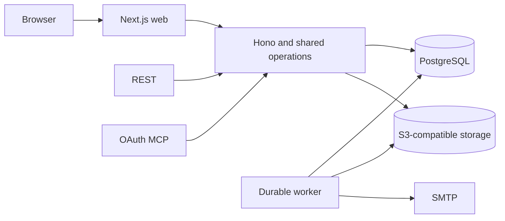

# Runtime and UI architecture

Rootset uses Node.js 24, TypeScript and pnpm workspaces. Hono serves REST, OAuth
and MCP; Next.js/React serves the browser; a PostgreSQL-backed worker runs durable
jobs. PostgreSQL 18 stores control records and native typed tables. S3-compatible
storage holds encrypted artifacts and SMTP delivers account/job email. Package
versions come from the workspace catalog and lockfile.

## Service boundaries

Expose a configured HTTPS origin for assets, API, authentication and MCP. Keep
server-only SQL and secret modules out of browser bundles. Use public dependencies
and self-contained packages; a Rootset installation needs no Towbar/Mill checkout.

The one baseline, `packages/database/migrations/0001_baseline.sql`, creates the
current schema directly. It is editable before V1 release. Normal digest checking
and refusal of incompatible prelaunch ledgers protect existing data. Runtime
schema journals manage user-table changes; they are not additional installation
migration variants.

## Database roles and work

Keep application, identity and restricted DDL logins separate from the privileged
migration/database-owner credential. SQL ownership is a database privilege, not
a Rootset membership role. The baseline enforces one organisation, and runtime
transactions resolve it together with current membership authority. Generated
internal IDs form managed schema/table/column names.

Use bounded connection pools, statement/transaction timeouts and worker
concurrency. A PostgreSQL restart produces a redacted error and reconnectable
future checkouts; interrupted transactions remain failed. Cancellation must join
its work before a connection can be reused. Test idle/active restart and concurrent
peer behavior against real PostgreSQL.

Workers hold fenced leases, heartbeat and commit data/checkpoints together. They
reconcile recorded outcomes after crashes instead of duplicating effects. Bound
uploads, retries and cleanup; expose partial outcomes and terminal failures.

## Spreadsheet

Use the public exports of `@avgeek-oss/design-system@1.2.4` for the application
shell, navigation, account settings, authentication, buttons, avatars, typography
and HeroUI controls. Rootset owns API adapters, permissions, UTC/date policy and
branding. Keep Rootset's green accent. The primary sidebar contains databases,
Account settings and Admin-only Team settings. It does not show the organisation
name. The bottom-left identity opens the account/product/sign-out menu. A top bar
provides the navigation toggle, current context and appearance control.

Each page owns its secondary sidebar, following Towbar and Mill. A database has
Database → Tables and Settings → General/Backups. Selecting a database opens its
Tables overview, adapted from Mill's Boards page with responsive widget cards
showing table names and row counts. Creating tables belongs to that page.
Selecting a card opens the table's Rows page, with its own secondary sidebar:
Table → Rows, Settings → General/Fields/Unique rules/Search indexes, and Data →
Import rows/Export rows. The database breadcrumb returns to the Tables overview.
Use Towbar's resource-heading typography for database and table names and omit
a settings button beside the sidebar title.

Account settings shows only Account, Security and API & MCP groups. Team settings
shows only Team and Installation groups. Neither includes database/table menus
or marks a database active in the primary sidebar. Database settings keep the
database navigation; table settings keep the table navigation. Account/team URLs
have no resource IDs, database settings URLs contain only databaseId, and table
URLs include both databaseId and tableId. Route parameters determine selection,
so browser history and reloads reproduce the same page without automatically
opening a first table. Keep live role checks for direct links and hide management
controls from non-admins. Narrow screens use a focus-trapping drawer containing
the primary navigation and the current page's secondary navigation; desktop
navigation can collapse with focus restoration.

The spreadsheet uses the existing accessible DOM grid with row virtualisation.
Load complete row windows and render every visible field, including columns
outside the horizontal viewport. Horizontal scrolling must not fetch column
projections or replace cell values with loading placeholders. The row index and
configured frozen columns use native CSS sticky positioning. Keep the grid inside
a bounded viewport with Filter immediately before Add row in the page header.
Export and table settings are available in the table's secondary sidebar.
Filter opens a HeroUI modal using Towbar Analytics' condition-row layout, with
typed values, all/any matching, removable conditions and Clear/Cancel/Apply
actions. The UI displays every field and has no sort, column-visibility, help or
manual reload controls. API/MCP query sorting and projection remain supported.
There is no standalone Background Jobs screen. Operation progress stays
with the import/export, schema or manual backup action that started the work.
SMTP and S3-compatible storage are configured only through environment variables;
there are no database overrides, provider forms, test-email action, editable
request/concurrency controls or storage admission subsystem.

Fetch bounded row windows and evict distant data. Deep navigation uses the query
window/anchor contract rather than unlimited OFFSET. Render visible rows with
small overscan and all fields; never load five million rows into the browser.

Single tap and keyboard entry open the typed editor. Preserve text, strict number,
boolean/null, date, UTC time, timezone-aware date-time and JSON editors. Enter/F2,
Tab/Shift-Tab, arrows and Escape must work without losing drafts. Conflicts show
current values and retain the user's draft until a deliberate retry.

Field names are the visible labels and JSON keys. A rename preserves the internal
field ID, column identity and history. Column resize/order/freeze are view
preferences. Copy/paste validates a bounded atomic batch or previews a larger
import. Review phone/desktop, light/dark, keyboard, touch and screen-reader states.

## Resource profile and deployment

The approved combined memory caps remain PostgreSQL 4 GiB, API 1 GiB, worker
2 GiB and web 1 GiB, totalling 8 GiB. Memory-plus-swap caps are the same, so swap
adds no headroom. Record CPU, disk, network and PostgreSQL settings for scale runs.
Record local S3/SMTP dependencies separately as test fixtures and measure browser
memory separately. Do not silently increase the approved four-service budget.

Use non-root application containers, narrow mounts, explicit environments and
health checks. Migration failure blocks runtime startup. Distinguish liveness
from readiness, and expose worker/dependency failures. Collect redacted query,
job, storage, history and backup metrics with request correlation.

The local Towbar README/contribution guide and Mill architecture/prelaunch guide
inform public dependency setup, current-role authorization, baseline refusal and
recovery conventions. Rootset retains its own three-role model and typed storage
contract. These references make no claim about Rootset runtime verification.
