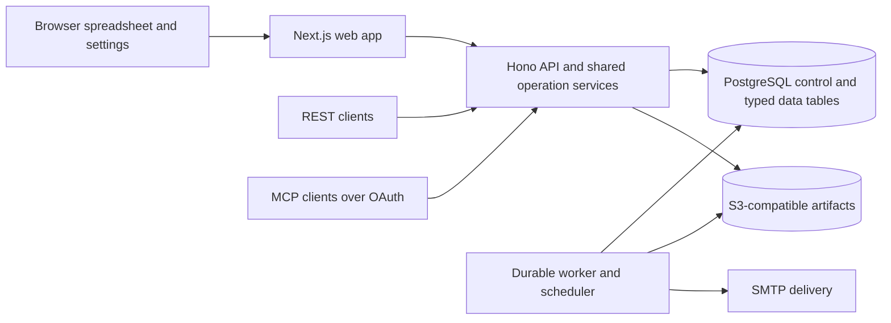

# Stack architecture

Baseline: 2026-10-02. Status: planned stack; no application is implemented. Related contracts: [account](ACCOUNT_ARCHITECTURE.md), [database](MDM_DATABASE_ARCHITECTURE.md), [API and MCP](API_AND_MCP_ARCHITECTURE.md), [implementation](IMPLEMENTATION_PLAN.md), and [verification](IMPLEMENTATION_VERIFICATION_CHECKLIST.md).

## Runtime components



The web app, API, and worker are separate processes from one repository. A reverse proxy exposes one configured HTTPS origin and routes browser assets, API, OAuth discovery, and MCP. Same-origin routing keeps authentication/cookie behavior predictable. A self-hosted installation needs PostgreSQL and configured artifact storage; the latter can be an existing compatible service rather than another mandatory database container.

## Technology choices

| Area            | Choice                                                  | Purpose                                                           |
| --------------- | ------------------------------------------------------- | ----------------------------------------------------------------- |
| Runtime         | Node.js 24 LTS, TypeScript                              | Shared contracts and Towbar-compatible development patterns.      |
| Repository      | pnpm workspaces, Turborepo                              | Separately buildable apps and shared packages.                    |
| HTTP API        | Hono on Node.js                                         | Browser/API/OAuth routes and request middleware.                  |
| Contracts       | Zod, JSON Schema 2020-12, OpenAPI 3.1.2                 | Validation, generated clients/docs, operation inventory.          |
| Identity        | Better Auth, passkey/TOTP/API-key adapters              | Towbar-derived authentication with Rootset-owned access rules.    |
| Metadata ORM    | Drizzle with PostgreSQL driver                          | Static control records and forward migrations.                    |
| User storage    | PostgreSQL 18                                           | Dynamic typed tables, transactions, history, uniqueness, RLS.     |
| Schema executor | Restricted PostgreSQL DDL service                       | Generated identifiers, operation journal, lock/cutover recovery.  |
| Worker queue    | PostgreSQL-backed durable jobs                          | Backups, imports, exports, schema work, outbox delivery.          |
| Web             | Next.js and React                                       | Towbar-style shell, settings, editable grid.                      |
| UI controls     | HeroUI, Tailwind CSS, React Aria where needed           | Typed inputs, overlays, focus, accessible account/settings UI.    |
| Grid            | Glide Data Grid candidate                               | Canvas/lazy visible-cell rendering and spreadsheet behavior.      |
| Query cache     | TanStack Query candidate                                | Bounded server-data windows, cancellation, mutation invalidation. |
| JSON editor     | CodeMirror 6                                            | Validated JSON cell editing in a bounded overlay.                 |
| Email           | React Email, SMTP adapter                               | Towbar template adaptation and transactional outbox.              |
| Artifacts       | S3-compatible API and encryption                        | Backups, export/import artifacts, history archives.               |
| Verification    | Unit tests, PostgreSQL integration tests, browser tests | Behavioral, concurrency, recovery, rendered and scale evidence.   |

Pin exact package versions during the bootstrap work package after compatibility and security checks. The reference Towbar lockfile is a starting point, not a requirement to copy every dependency. Libraries marked candidate require a spike. Do not introduce Temporal, Redis, Kafka, ClickHouse, or an external search engine as mandatory v1 services without a reviewed requirement and new operating evidence.

The PostgreSQL-backed queue must support leases, heartbeat, retries, idempotency, cancellation, progress, and terminal states. Choose a maintained queue library or a reviewed bounded implementation during the worker spike. Long-running operations are asynchronous even when the user starts them through MCP.

## Planned repository layout

```text
apps/
  rootset-api/              HTTP, OAuth and MCP adapters
  rootset-web/              application shell, grid, settings and auth
  rootset-worker/           scheduler and durable operation workers
packages/
  contracts/               operation definitions, schemas and serializers
  core/                    domain operations and validation
  access/                  actors, operation scopes and resource grants
  database/                control schema, migrations and transaction adapters
  table-storage/           SQL compiler, dynamic DDL, history and uniqueness
  web-client/              generated typed API client
  identity-web-ui/          adapted authentication components
  email/                   rebranded templates and rendering
tools/
  verification/            scenario runners, fixtures and report collection
rc-plan/                   architecture and sign-off contract
```

This layout describes future implementation. Do not add empty apps and claim the work package complete. Packages have explicit exports and narrow dependencies; frontend code cannot import SQL, credentials, or server-only identity modules. Own the required code in this repository or use public packages; a fresh clone must not need Towbar's private registry access.

## Operation and storage boundaries

An operation has a stable ID, transport schema, permissions, target resolver, mutation/step-up metadata, executor, output schema, and audit definition. Browser, REST, MCP, and job workers use the same domain implementation. Workers execute a persisted, authorised job specification and revalidate required access where the account/resource lifecycle demands it.

The API uses a non-owner database role with forced organisation RLS. The schema worker uses a separate role restricted to managed namespaces. Only migrations/operator recovery use broader privileges. Use explicit transaction-local context with the pooled driver; reset or reject contaminated sessions. The worker never builds SQL names from free-form labels.

Use bounded connection pools and transaction/query timeouts. Foreground reads cannot queue behind an unbounded import. Reserve worker concurrency and database connections so a backup/schema job does not exhaust API capacity. Role/resource revocations invalidate relevant cached authorisation; no indefinite access cache is allowed.

## Spreadsheet architecture

The main sidebar lists logical databases. Selecting one displays its tables in the secondary sidebar. The content pane contains a table toolbar, pinned column headers, viewport cells, and loading/error feedback. Database/table creation and settings are reachable without replacing the grid with a dashboard. Organisation selection and account/settings use the Towbar shell patterns.

The frontend keeps table metadata separate from row windows. A cell reads from a bounded cache keyed by table, schema version, query digest, row ID, and projection. The grid renders visible columns/rows plus a small overscan. Fetch nearby windows; cancel stale requests when filters, sort, table, or permissions change. Evict distant windows and never accumulate the entire dataset while scrolling.

The grid spike must prove five-million-row logical navigation, including browser scroll-height limits and the server's anchor/window navigation contract. Do not equate canvas rendering with successful deep database pagination. Large filtered views may use query-session anchors and explicit loading states. Record the chosen algorithm before committing the library choice.

Single tap opens the relevant editor. Text uses a bounded input, numeric fields use strict numeric input, boolean uses a toggle with a distinct null state, dates/date-times use appropriate pickers, time uses a UTC-labelled time input, and JSON uses a lazily loaded editor overlay. Keyboard editing supports Enter/F2 or direct typing, Tab/Shift-Tab navigation, arrows, Escape cancellation, and a clear commit gesture. Touch controls and validation feedback are accessible; numeric/date editors must not silently reinterpret locale-formatted text.

Use local draft state for active editing. Submit a mutation with expected row/schema revision. Show pending state without claiming saved data; confirmed server values and revisions become authoritative. On rejection retain the draft and show field-level reasons. On concurrent conflict display the current value and let the user deliberately retry. One-cell changes invalidate or update only affected cached cells/windows. Server sort/filter membership changes are reconciled without dropping the draft.

Copy/paste accepts rectangular cell selections with schema-aware validation. A small paste is an atomic batch; larger pastes become imports after a visible preview. Column resize/reorder/freeze are view preferences and do not mutate field API keys. JSON cells show a bounded summary; full parsing/editor work is deferred until editing. Internal row IDs remain absent from visible user columns.

Canvas-based grids need a proven accessible focus/announcement path. Test keyboard-only navigation, screen readers, high zoom, mobile/touch, high contrast, and reduced motion. If the selected grid cannot meet those gates, choose another renderer or an accessible equivalent view before sign-off. A fallback cannot silently remove editing/history capabilities.

## Background processing

Persist job specifications and progress in PostgreSQL. Job types include import, export, backup, restore, schema conversion, constraint/index build, retention, account/resource deletion, and outbox delivery. A job contains organisation, target, operation, requester actor, request digest, attempt/lease state, checkpoint, progress counters, timestamps, and redacted failure detail.

Only one worker holds a lease. Heartbeats extend it; expired leases permit recovery. Persist each committed batch checkpoint with its data mutation. External uploads have deterministic run/object IDs and explicit reconciliation so retries do not duplicate backups. A cancellation request reaches a safe checkpoint and reports whether any data already committed.

Cron evaluation records scheduled UTC occurrences using the configured IANA timezone and documented daylight-saving policy. Scheduler restart and multiple scheduler instances must not double-run an occurrence. Workers expose queue delay, attempt counts, stale leases, and failures. The API returns job IDs immediately and offers polling/events; an accepted HTTP/MCP response is not terminal success.

## Configuration and deployment

Ship a documented Docker Compose installation with web, API, worker, and PostgreSQL, plus reverse-proxy configuration. Support external PostgreSQL and S3-compatible storage. Keep artifact storage configuration separate from a logical database's backup policy. Specify volumes, non-root users, health/readiness checks, restart behavior, resource budgets, and upgrade commands.

Required configuration includes base URL, database URLs for application/DDL roles, bootstrap secret, authentication/hash/encryption secrets, SMTP, object storage, logging, and worker/query budgets. All names use a `ROOTSET_` prefix. Provide `.env.example` with placeholders and validation. Persist encryption/hash keys across restart and provide rotation and disaster-recovery procedures. Never generate a new key silently when decrypting existing data fails.

Use forward control-schema migrations and a schema-journal reconciler for dynamic user data. An upgrade first verifies a recovery backup and compatibility, applies migrations, performs readiness checks, and reports the result. Document whether rollback is supported for each schema version; code rollback cannot undo arbitrary data migrations. Clean-install and in-place upgrade evidence are different gates.

The initial repository is private. Image publishing, public source distribution, DNS, TLS provisioning for a public service, and production deployment are separate actions. This plan does not configure them.

## Observability and capacity

Structured logs include request/job/operation IDs and redacted actor/target attribution. Metrics cover latency/error rate, query timeout, row admission, history growth, index build/size, queue delay, lease recovery, backup age/verification, object-store/SMTP failures, connection pool occupancy, disk/WAL use, and grid loading/mutation errors.

Expose liveness and readiness separately. Readiness checks actual dependencies needed for service, migrations, and table-journal compatibility. SMTP outage should report degraded delivery without blocking authorised data reads. A backup destination outage should fail backups visibly without masquerading as corrupt live data. Worker health requires successful polling/heartbeat, not merely a running process.

The performance profile, workloads, and thresholds are specified in the [verification checklist](IMPLEMENTATION_VERIFICATION_CHECKLIST.md). Benchmark wide rows, selective and scanning filters, large JSON, sort/window navigation, multi-user edits, history lookup, imports, backups, and restarts. Track memory and frame times in Safari as well as Chromium. Re-run affected checks when the storage/query/grid implementation changes.

## Sources and adoption gates

- [Glide Data Grid documentation](https://docs.grid.glideapps.com/) establishes the candidate's rendering/editing capabilities; the Rootset spike proves application behavior.
- [OpenAPI 3.1.2](https://spec.openapis.org/oas/v3.1.2.html) defines the planned HTTP description format.
- [PostgreSQL constraints](https://www.postgresql.org/docs/18/ddl-constraints.html), [CREATE INDEX](https://www.postgresql.org/docs/current/sql-createindex.html), and [ALTER TABLE](https://www.postgresql.org/docs/current/sql-altertable.html) guide enforcement and job planning.
- Towbar's exact source baseline and adaptation map are in [account architecture](ACCOUNT_ARCHITECTURE.md).

Runtime/package choices need install/build evidence, schema tactics need PostgreSQL concurrency/recovery evidence, and the renderer needs browser evidence. None of those can be signed off from architecture prose alone.
